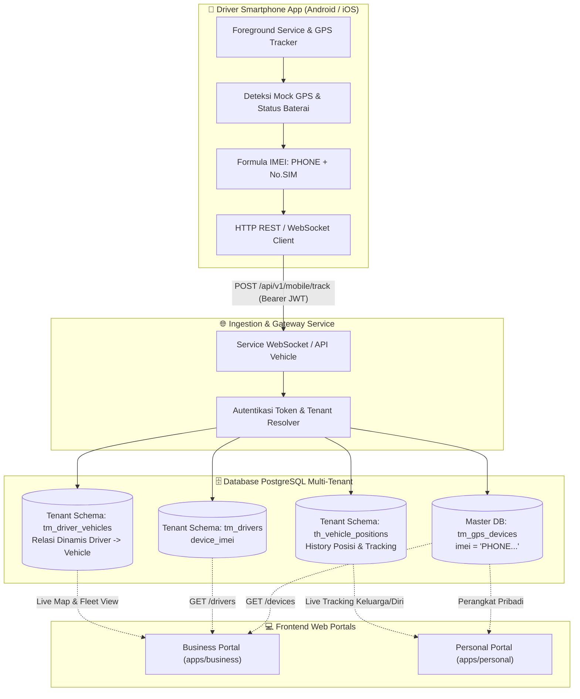

# Penerapan GPS Smartphone pada Platform AdaTrack

Dokumen ini menjelaskan arsitektur, filosofi desain, struktur data, alur bisnis, serta panduan implementasi teknis integrasi **GPS Smartphone (Driver & Workforce Telematics)** pada frontend Business Portal (`apps/business`) dan Personal Portal (`apps/personal`).

---

## 1. Filosofi & Latar Belakang Desain

Dalam industri telematika modern, terdapat pemisahan peran yang mendasar antara **Pelacakan Aset (Asset Telematics)** dan **Pelacakan Tenaga Kerja (Workforce Telematics)**:

| Aspek | GPS Fisik (Hardware Tracker) | GPS Smartphone (Mobile App) |
| :--- | :--- | :--- |
| **Fokus Utama** | Pelindung Aset Mesin & Kendaraan (*Asset-Centric*) | Pemantauan Supir & Tugas Lapangan (*Driver-Centric*) |
| **Subjek yang Dilacak** | Kendaraan statis (`tm_vehicles`) | Pengemudi manusia (`tm_drivers`) |
| **Sumber Daya** | Aki kendaraan (ACC ignition & baterai mobil) | Baterai ponsel pengemudi |
| **Arah Komunikasi** | Satu arah (pengiriman telemetri sensorik) | Dua arah (telemetri + UI interaktif layar sentuh) |
| **Instalasi** | Butuh instalasi fisik ke dashboard/kelistrikan | Tanpa instalasi fisik (*Zero Hardware Friction*) |
| **Peran di AdaTrack** | Keamanan aset armada 24/7, anti-maling | Pemantauan supir, absensi, e-POD, checklist |

### Mengapa GPS Smartphone Diterapkan?
1. **Bukan Pengganti GPS Fisik**: GPS Smartphone tidak ditujukan untuk menggantikan GPS fisik sebagai pelindung keamanan mobil anti-maling.
2. **Pusat Pelacakan Pengemudi**: GPS fisik tidak dapat mendeteksi siapa yang menyetir mobil secara spesifik (kecuali dengan reader RFID iButton mahal). Smartphone terikat langsung pada akun pengemudi.
3. **Pondasi Fitur Operasional Interaktif**: Layar smartphone memungkinkan pengembangan modul-modul bisnis lanjutan:
   - **Digital Proof of Delivery (e-POD)**: Tanda tangan digital penerima dan foto barang saat sampai.
   - **Pre-trip Inspection**: Checklist kondisi kendaraan (ban, rem, bodi) sebelum berangkat.
   - **Order Dispatching**: Penugasan rute & pengiriman baru secara langsung ke genggaman supir.
4. **Pendaftaran Terkontrol oleh Admin**: Pendaftaran perangkat smartphone dilakukan oleh admin bisnis/perusahaan untuk memastikan lisensi dan kuota perangkat tetap terjaga serta mencegah duplikasi sembarangan.

---

## 2. Arsitektur Sistem

Berikut adalah alur end-to-end integrasi GPS Smartphone dari aplikasi mobile driver hingga ditampilkan di web portal:



---

## 3. Aturan Identifikasi & Formula IMEI Otomatis

### Mengapa Menggunakan Formula `PHONE + Nomor SIM`?
1. **Regulasi Privasi OS Mobile**: Sejak Android 10+ (`READ_PRIVILEGED_PHONE_STATE`) dan pada seluruh versi iOS, sistem operasi memblokir keras aplikasi pihak ketiga non-sistem membaca nomor IMEI hardware ponsel.
2. **Standardisasi Identitas Unik**: Nomor SIM/telepon pengemudi bersifat unik secara global.
3. **Formula**:
   $$\text{IMEI} = \text{"PHONE"} + \text{Nomor SIM tanpa spasi}$$
   *Contoh*: Nomor SIM `08123456789` $\rightarrow$ IMEI / ID Perangkat: `PHONE08123456789`.

### Validasi & Keamanan:
- Input nomor SIM dibersihkan dari spasi dan karakter khusus sebelum digabung.
- Field IMEI pada form web disetel **Read-Only / Disabled** agar admin tidak memasukkan string acak yang berbeda dengan format aplikasi mobile.
- Database master memberlakukan *Unique Constraint* pada kolom `imei`.

---

## 4. Struktur Database & Model Relasi

### A. Master Schema (`adatrack_gps_master.tm_gps_devices`)
Menyimpan registrasi seluruh perangkat GPS fisik maupun smartphone yang aktif di sistem:
```sql
CREATE TABLE adatrack_gps_master.tm_gps_devices (
    imei VARCHAR(50) PRIMARY KEY,       -- Format: 'PHONE08123456789'
    device_brand VARCHAR(50) NOT NULL,  -- Default: 'Android / iOS'
    device_model VARCHAR(50) NOT NULL,  -- Default: 'Mobile Tracking App'
    sim_number VARCHAR(30),             -- Nomor SIM / HP Driver
    protocol VARCHAR(30) NOT NULL,      -- 'SMARTPHONE' atau 'HTTP_MOBILE'
    iccid VARCHAR(30),                  -- Nomor seri kartu SIM (opsional)
    assigned_company VARCHAR(50),       -- Kode Tenant (misal: 'TESST001')
    status VARCHAR(20) DEFAULT 'idle',  -- 'idle' (siap pakai) | 'assigned' (terpasang)
    created_at TIMESTAMP DEFAULT CURRENT_TIMESTAMP,
    updated_at TIMESTAMP DEFAULT CURRENT_TIMESTAMP
);
```

### B. Tenant Schema (`adatrack_gps_<tenant>.tm_drivers`)
Menyimpan data master pengemudi dan relasi ke perangkat smartphone:
```sql
ALTER TABLE tm_drivers 
ADD COLUMN device_imei VARCHAR(50);

-- Satu perangkat smartphone hanya dapat aktif pada satu pengemudi
CREATE UNIQUE INDEX uq_tm_drivers_device_imei 
ON tm_drivers (device_imei) 
WHERE device_imei IS NOT NULL AND deleted_at IS NULL;
```

### C. Relasi Dinamis Driver ke Kendaraan (`tm_driver_vehicles`)
* Saat supir mengemudikan kendaraan armada, relasi dicatat di tabel pivot `tm_driver_vehicles`.
* Pada tampilan *Live Tracking* dan peta armada, lokasi GPS yang dikirimkan oleh ponsel supir secara otomatis memposisikan armada yang sedang dikendarai oleh supir tersebut.
* Jika supir tidak sedang ditugaskan pada kendaraan manapun, posisi GPS supir tetap terpantau sebagai personel lapangan aktif (*Field Worker Tracking*).

---

## 5. Implementasi Frontend Business Portal (`apps/business`)

Portal Bisnis ditujukan untuk manajemen armada B2B perusahaan dengan banyak kendaraan dan pengemudi.

### A. Modul Perangkat (`features/core/devices`)
1. **Restriksi Protokol Pendaftaran**:
   - Di Portal Bisnis, admin **hanya dapat mendaftarkan protokol Smartphone** (`SMARTPHONE` / `HTTP_MOBILE`).
   - Pendaftaran perangkat GPS fisik hanya dapat dilakukan melalui Superadmin Portal (`apps/admin`) demi menjaga integritas stok perangkat keras.
   - Perangkat GPS fisik yang ada di daftar portal bisnis berstatus *read-only*.
2. **Form Pendaftaran Perangkat (`DeviceForm.tsx`)**:
   - **Autofokus Pertama**: Kursor input langsung fokus ke input **Nomor SIM / Telepon** saat form/modal dibuka.
   - **Komponen Autocomplete (`InputAutocomplete.tsx`)**:
     - Menampilkan dropdown rekomendasi nomor HP pengemudi yang belum memiliki perangkat smartphone (`drivers` tanpa `device_imei`).
     - Admin dapat memilih salah satu pengemudi atau mengetikkan nomor SIM baru secara manual.
   - **Auto-Generate IMEI**: Saat nomor SIM diketik atau dipilih, field IMEI otomatis terisi dengan formula `PHONE + nomor SIM`.
   - **Penghapusan Penautan Supir di Form Device**: Form perangkat murni untuk inventarisasi perangkat. Status perangkat yang baru didaftarkan adalah `'idle'`.
3. **Tabel & Drawer Detail (`DeviceTable.tsx`, `DeviceView.tsx`)**:
   - Menampilkan kolom **Pengemudi Tertaut** (nama supir dan nomor HP).
   - Menampilkan indikator kendaraan yang sedang dikemudikan secara dinamis.
   - Status otomatis berubah menjadi **Terpasang (Assigned)** jika perangkat sedang ditautkan ke supir.

### B. Modul Pengemudi (`features/core/drivers`)
1. **Pusat Penautan Perangkat (*Single Point of Truth*)**:
   - Penautan dan pelepasan smartphone dilakukan di **Form Pengemudi (`DriverForm.tsx`)**.
   - Dropdown memilih dari daftar smartphone berstatus `idle` (atau smartphone yang saat ini sedang dipakai pengemudi tersebut).
2. **Pelepasan Perangkat**:
   - Jika penautan perangkat dilepas di form supir, backend secara otomatis membersihkan `tm_drivers.device_imei = NULL` dan mengembalikan status perangkat di master menjadi `'idle'`.
   - Jika supir dihapus (*soft delete*), perangkat otomatis kembali ke status `'idle'`.

---

## 6. Implementasi Frontend Personal Portal (`apps/personal`)

Portal Personal ditujukan untuk pengguna perorangan, keluarga, atau bisnis mikro dengan 1–3 kendaraan.

### Karakteristik & Perbedaan dengan Business Portal:
1. **Model Penggunaan Sederhana**:
   - Pada akun personal, pengguna tidak mengelola banyak supir formal. Pengemudi umumnya adalah pemilik akun itu sendiri atau anggota keluarga.
2. **Pendaftaran Instan**:
   - Pengguna cukup memasukkan nomor ponsel yang akan dijadikan pelacak.
   - Sistem langsung membuatkan identitas perangkat dan menyediakan petunjuk instalasi aplikasi mobile serta *QR Code login* untuk di-scan oleh smartphone.
3. **Pemetaan Langsung ke Kendaraan Pribadi**:
   - Pada portal personal, perangkat smartphone dapat langsung ditautkan ke kendaraan pribadi (misal: "Mobil Toyota Avanza Ayah").
   - Begitu smartphone aktif bergerak, posisi mobil di dashboard personal langsung ter-update secara *real-time*.

---

## 7. Spesifikasi Protokol Komunikasi Mobile App (API Telemetri)

Aplikasi mobile driver berkomunikasi dengan backend melalui REST HTTP atau WebSocket.

### Endpoint Kirim Lokasi:
`POST /api/v1/mobile/track`

### Header:
```http
Authorization: Bearer <DRIVER_JWT_TOKEN>
Content-Type: application/json
```

### Request Payload:
```json
{
  "imei": "PHONE08123456789",
  "latitude": -6.2088,
  "longitude": 106.8456,
  "altitude": 18.5,
  "speed": 42.5,
  "heading": 180.0,
  "accuracy": 4.2,
  "battery_level": 85,
  "is_charging": true,
  "mock_detected": false,
  "recorded_at": "2026-10-16T16:30:00Z"
}
```

### Response:
```json
{
  "status": "success",
  "message": "Telemetry acknowledged"
}
```

---

## 8. Panduan Teknis Lapangan & Mitigasi Masalah (Best Practices)

Untuk memastikan pelacakan GPS Smartphone berjalan optimal di lingkungan nyata:

### 1. Mengatasi Pembatasan Daya Android (Battery Doze Mode)
* **Wajib Menggunakan Android Foreground Service**: Aplikasi mobile harus menjalankan service pelacakan dengan `NotificationCompat.Builder` berprioritas tinggi di status bar.
* **Izin Background Location**: Meminta izin `ACCESS_FINE_LOCATION` dan `ACCESS_BACKGROUND_LOCATION` (Android 10+).
* **Panduan Pengaturan Ponsel**: Aplikasi mobile harus menyediakan wizard "Izinkan Berjalan di Latar Belakang" untuk mematikan *Battery Optimization* spesifik merk (Samsung, Xiaomi MIUI/HyperOS, Oppo ColorOS, Vivo Funtouch).

### 2. Pencegahan Kecurangan (Anti-Mock & Tamper Detection)
* **Deteksi Fake GPS**: Periksa `location.isFromMockProvider()` di Android. Jika `true`, tolak pengiriman koordinat dan kirim peringatan insiden integritas ke portal admin.
* **Offline Caching**: Jika supir melewati area tanpa sinyal seluler / blank spot, aplikasi menyimpan titik-titik koordinat di database lokal SQLite ponsel, lalu mengirimkannya secara berurutan (*batch upload*) saat sinyal kembali pulih.

### 3. Efisiensi Baterai Ponsel
* **Dynamic Sampling Interval**:
  * Saat kendaraan diam / parkir: interval pembaruan GPS diperlambat (misal: setiap 60 detik).
  * Saat kendaraan bergerak: interval dipercepat (misal: setiap 5–10 detik).
  * Menggunakan sensor accelerometer / activity recognition untuk mendeteksi pergerakan tanpa membebani modul GPS terus menerus.

---

## 9. Rangkuman File Terkait

| Komponen | Lokasi File | Deskripsi |
| :--- | :--- | :--- |
| **Form Device** | `apps/business/src/features/core/devices/components/DeviceForm.tsx` | Form input nomor SIM (autofocus), auto formula IMEI, spec smartphone |
| **Autocomplete Input** | `packages/ui/src/form/InputAutocomplete.tsx` | Komponen dropdown rekomendasi nomor HP supir dan input manual |
| **Form Driver** | `apps/business/src/features/core/drivers/components/DriverForm.tsx` | Tempat penautan perangkat GPS Smartphone ke akun pengemudi |
| **Schema Validasi** | `apps/business/src/features/core/devices/types/device.ts` | Skema validasi Zod untuk perangkat smartphone |
| **Kamus Bahasa** | `apps/business/src/features/core/devices/i18n.ts` | Terjemahan ID & EN untuk perangkat smartphone & formula IMEI |
| **Backend Handler Devices** | `services/service-websocket/internal/api/handlers_tenant_devices.go` | CRUD perangkat tenant dan validasi protokol smartphone |
| **Backend Handler Drivers** | `services/service-websocket/internal/api/handlers_drivers.go` | Penautan `device_imei` pada supir dan sinkronisasi status perangkat |
| **Migrasi Database** | `database/migrations/company_pg/039_add_device_imei_to_drivers.up.sql` | Kolom `device_imei` & partial unique constraint di `tm_drivers` |
